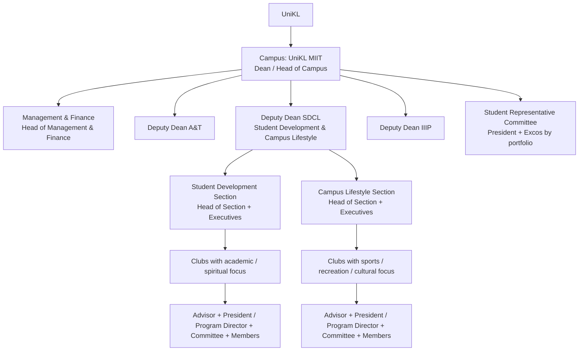

# UniPact Campus: Club System Plan (UniSkill port + SRS v2.2.1 plug-in)

Status: **draft for review**. Nothing here is built yet.
Branch: `claude/club-system-implementation-uxekcn`

---

## 1. What this is

UniKL has cleared UniPact to run a club system. The Dean wants a **pilot that shows results** before a wider rollout.

- **Core of the pilot: UniSkill** (Ashraf Rahimi's FYP, supervised by Ts. Dr. Noor Widasuria). It covers club membership, club activities, advisor oversight, SDCL administration and GHOCS co-curricular points. We rebuild it inside UniPact (Django + React) rather than run the Laravel app beside it.
- **Prepared to plug in: SRS v2.2.1** (club sponsorships from companies). It is already in the codebase but was postponed until a university approved it. Once UniSkill clubs exist and are verified by the university, the v2.2.1 sponsorship flow attaches to them.

### 1.1 Sources studied

| Source | Read | Notes |
|---|---|---|
| UniKLSKILL SRS v2.0 (PDF, 150 pages) | In full, including the NFRs (§5), compliance (§6) and the UML class diagram | |
| UniKLSKILL FYP2 Report (PDF, 149 pages) | In full, including all 8 modules, UAT results, the UML diagram, the database screenshot and the GHOCS form and transcript screenshots | |
| UniKLSKILL STP v2 (PDF) | Module lists per role, test approach, risk table, sample cases | |
| Research paper (PDF) | In full | UAT results (30 students) and future recommendations |
| Presentation slides (PDF) | In full | Includes the radar-chart problem slide |
| GHOC Mapping & point distribution (DOCX) | In full | DNA categories → SC1–SC5 skills, S.P.I.C.E.S elements |
| `uniklskill.zip` (Laravel source, 235 MB) | **Not read** | Too large for the Drive connector (10 MB limit), and Drive downloads are blocked from the build container. The table names are known from the report (§2.1). Only the exact column lists are missing. |
| GHOCS User Manual for Student v2.0, GHOCS paper (2017), 3 GHOCS UniKL screenshots | In full, including the form screenshots | Approval stages, form fields, point components (§2.2) |
| MIIT "Template Proposal SAF 2026" (SD and CL, Dean and Deputy Dean versions), Ashraf's club proposal template | In full | The real approval chain and hierarchy (§3.2, §3.4) |
| UniPact SRS v2.2.1 (DOCX in repo) | In full | REQ-3.1.5, 3.1.12, 3.2.x, 3.4.x, 3.6.x |
| UniPact codebase | Club track: `users/models.py`, `campaigns/models.py`, club views and serializers, `impact/` check-in, architecture lock | |

---

## 2. What UniSkill does (condensed)

**Users:** Student, Student (High-Committee), Club Advisor (lecturer), Secretary (staff), SDCL Admin.

| # | Module | Features |
|---|---|---|
| 1 | Accounts | F001–F003: register (username, student ID, email, password), log in, log out |
| 2 | Club members | F004–F007: join request → High-Committee or Advisor approves or rejects; add and remove members; Advisor promotes and demotes High-Committee and sets each person's position |
| 3 | Club activities | F008–F014: High-Committee proposes → Advisor approves (the STP adds "before submission to SDCL") → published; Advisor can post directly; members-only discussion thread per activity; post-activity report → Advisor remarks |
| 4 | Club establishment | F015–F019: a student proposes a new club → SDCL approves → SDCL creates, edits or removes the club |
| 5 | Advisors | F020–F022: SDCL assigns and unassigns advisors; the advisor is notified |
| 6 | News | F023–F025: SDCL posts site news |
| 7 | Co-curricular points (GHOCS) | F026–F030: a student submits an achievement with a certificate → Secretary approves and allocates points → the student sees their total and prints a transcript |
| 8 | FAQ chatbot | F031–F032 |

### 2.1 What the full report and screenshots add

- **Ashraf's real database tables** (phpMyAdmin screenshot in the report, Figure 4.3):
  - Clubs and members: `clubs`, `club_members`, `club_join_requests`, `club_proposals`, `club_socials`, `club_announcements`, `announcement_comments`
  - Activities: `activity_proposals`, `posted_activities`, `activity_comments`
  - Reports: `club_reports` (with `reference_type`/`reference_id` pointing to an activity or announcement, an attachment, and `advisor_remarks`)
  - News: `news`, `proposal_news`
  - GHOCS: `merit_proposals`, `student_points`, `proposal_templates`
  - Other: `faqs`, `notifications`

  Each maps one-to-one onto a model in §4.
- **News is not admin-only.** Any logged-in user can propose a news post or a non-club activity. The admin approves it. A post can be marked **"GHOCS-claimable"**, which adds activity level, UniKL DNA category, GHOCS element, start and end dates, and location.
- **Staff accounts are created by the admin.** Staff never sign up themselves. This matches the invite-only `STAFF` plan.
- **The GHOCS claim form ("My Excellence")** has these fields:
  - optional reference to a posted activity or news item (this auto-fills the form)
  - title
  - activity level (Campus / University / National / …)
  - DNA category
  - GHOCS element (S.P.I.C.E.S)
  - date
  - achievement level
  - description (group or individual, placement)
  - evidence upload

  The Secretary approves, or rejects with a reason. The student sees a request table with status and the rejection reason.
- **The transcript groups points into five buckets:** Excellence, Skill Development, UniKL DNA, SPICE and Management Skills. It then shows SC1–SC5 percentages and a radar chart. In Ashraf's form the student still picks the DNA category even when they referenced an activity. Our change is to lock the category when the claim references an activity.
- **Non-functional requirements** carried over:
  - pages load in under 3 s
  - email within 1 minute of the event
  - 100 concurrent users
  - uploads limited to PDF, DOCX and images
  - role checks that cannot be bypassed through the URL
  - PDPA consent and a Terms of Use
  - mobile-friendly

  UniPact already meets the upload, consent and email requirements.
- **UAT baseline:** 30 MIIT students, 4 of them High-Committee. Functionality 61.3% strongly agree, usability 60.7%, satisfaction 62.0%. The weakest point was interface consistency, with 10% neutral. UniPact's style guide addresses that.

### 2.2 What the official GHOCS sources add

Sources: *GHOCS User Manual for Student v2.0*, the GHOCS paper (Awang Long et al., 2017), and the 3 GHOCS UniKL story screenshots.

- **Approvals have 2–3 stages, not one.** These are the stages GHOCS uses today:
  - **Club proposal:** *verified* by the Advisor or SDCL staff, then *approved* by the Dean, Deputy Dean or SDCL head.
  - **Activity proposals** (club and non-club): **Verification → Recommendation → Approval**.
  - **Excellence claim:** has both a "Verify Reason" and an "Approve Reason" field, so it is two-stage too.
  - **Activity report:** emails the applicant and SDCL staff.

  This confirms the configurable approval chain in §3.4.
- **Club management is not limited to clubs.** The "Club Management" component counts management skills from **Club High Committee, SRC, USRC and RCC** (Student Representative Council, University SRC, Residential College Committee). It is evaluated with a **CITC rubric (360° assessment)**. These bodies are added to the org tree in §3.2.
- **Membership is per semester.** The activity profile lists each club per semester with position (MEMBER, COMMITTEE / EXCO), start date and end date. A student re-appears every semester. This matches the term on `RoleAssignment` in §3.3.
- **GHOCS has four point components.** These are what students already see on the official transcript (sample in the paper):

| Component | What earns points |
|---|---|
| **Skills Development** | General and language subjects from Student Development |
| **UniKL DNA** | All activities. This is the main component and feeds SC1–SC5. |
| **Excellence** | Awards, competitions, mobility |
| **Management Skills** | Committee roles, via the CITC rubric |

  The transcript shows: Total GHOCS Points, total activity count, SC1–SC5 percentages, and the spider web chart.
- **Activity proposal fields:**
  - email, name, level, category, merit elements (multi-select S.P.I.C.E.S), location, description, start and end, estimated participants, budget (RM)
  - additional info: logistics (item × qty), vehicle, sponsor, participants, person in charge
  - proposal file
- **Activity report fields:** merit elements, participants, summary, budget used, file. Students see a dashboard reminder ("Please submit your activity report for …") until the report is in.
- **Excellence claim fields:** title, level, merit element, achievement (from a fixed list), entrepreneurship flag, semester, type (Individual / Group), award title, year, date awarded, rank (1st place …), description, attachment (.doc, .docx, .pdf).
- **Login:** students and staff log in through **UniKL SSO (CAS at `cas.unikl.edu.my`)**. SSO is the natural later integration (Phase 4). The pilot uses UniPact accounts plus university-email verification.
- **Scale:** 65,487 activities were recorded in GHOCS from Sept 2015 across 12 campuses, about 27 activities per campus per week, with 136–774 students per graduating batch. MIIT recorded 7,152 activities (71% UniKL DNA, 6% Excellence, 23% Club Membership).

**Still not found anywhere:** the number of points per level, achievement and role. GHOCS computes them internally. The pilot must get this table from SDCL, or label points as estimates.

**Problems it set out to solve:**
- **P1:** Club information is scattered across ECITIE, WhatsApp and Teams.
- **P2:** GHOCS claims get rejected because students pick the wrong category.
- **P3:** Secretaries miss old claims, so points arrive late or never.
- **P4 (from the GHOC mapping doc):** the radar chart is opaque. More GHOCS points does not mean a bigger radar, and students cannot see how to improve it.

**UniSkill's own future recommendations**, which UniPact already covers or can cover:
- Live email notifications: UniPact already has them (`notifications.py`).
- A real, scalable database: UniPact runs on Postgres.
- Integration with the official UniKL database: planned as Phase 4.
- A smarter chatbot: Phase 4.

---

## 3. Hierarchy: the core design decision

Both earlier options were rejected because UniKL has many levels. Neither "add three global roles" nor "per-club role only" can express someone who is, at the same time:

- an MIIT lecturer,
- advisor of Club A,
- co-advisor of Club B,
- and a GHOCS secretary for one section.

Nor can they express a student who is President of one club and an ordinary member of two others.

### 3.1 Principle: separate *who you are* from *what you can do, and where*

1. **Account type** (`User.Role`): what kind of person logs in. This stays small and global. It also preserves the architecture lock: `STUDENT`, `CLUB`, `COMPANY` and `ADMIN` all stay exactly as they are.
   - We add **one** account type, `STAFF`, for university lecturers and officers. They are not students, companies or UniPact admins, and they must not see the student marketplace.
2. **Organisation tree:** UniKL's structure stored as data, not code. A new campus or section is a new row, not a migration.
3. **Role assignments:** each one is *(person, role, scope node, term)*. Permissions come from the assignments, and a role granted on a node also covers everything below it.

### 3.2 Organisation tree (from MIIT's 2026 proposal templates)

Source: the four *Template Proposal SAF 2026* forms (SD and CL versions, each with a Dean-approval and a Deputy-Dean-approval variant). Every person who signs a club proposal at MIIT appears on them. Only titles are used here, not names.



What the templates show:
- **Each club or programme belongs to a "sector"**, either SD (Student Development) or CL (Campus Lifestyle). The sector decides which section's staff review it and which SRC Exco acknowledges it. For example, *Exco Academic & Spiritual* signs for SD and *Exco Sports, Recreational & Cultural* signs for CL.
- **The SRC is part of the approval chain.** The portfolio Exco acknowledges the proposal and the SRC President endorses the budget. So SRC is not just a club-like body: its officers hold approval roles.
- **There are three Deputy Deans:** A&T, SDCL and IIIP. The template is addressed to the relevant one. Club activities normally go to DD SDCL.
- **Head of Management & Finance** recommends on every budget.

`OrgUnit(id, parent, kind ∈ {UNIVERSITY, CAMPUS, OFFICE, SECTION, CLUB, BODY}, name, code, sector, is_active)`:
- `OFFICE` covers the Dean, the Deputy Deans and Management & Finance.
- `SECTION` covers SD and CL.
- `BODY` covers SRC and later RCC/USRC.
- `sector` holds SD or CL on clubs and sections.

A **Club** is an `OrgUnit` of kind `CLUB` plus a `Club` detail record (description, logo, DNA category, sector, status, socials). Other campuses get the same shape, with their own offices and sections as data.

### 3.3 Roles and where they apply

| Role | Assigned at | Signs on the MIIT form as | Can do in the system |
|---|---|---|---|
| `PLATFORM_ADMIN` | global (`User.Role.ADMIN`) | — | Everything; onboards universities and campuses |
| `DEAN` | Campus | Dean / Head of Campus | Final approval for budget > RM 5K; campus reports |
| `DEPUTY_DEAN` | Office (A&T, SDCL, IIIP) | Deputy Dean | Approves budget ≤ RM 5K; recommends budget > RM 5K; approves new clubs |
| `HEAD_FINANCE` | Office (Management & Finance) | Head of Management & Finance | Recommends or not-recommends every budget |
| `HEAD_OF_SECTION` | Section (SD / CL) | "Verified by" | Verifies proposals in their sector; assigns advisors; manages clubs and news for the sector |
| `SECTION_EXECUTIVE` | Section (SD / CL) | "Reviewed by" | Reviews proposals; day-to-day club admin |
| `GHOCS_SECRETARY` | Section or Campus | — | Verifies GHOCS / Excellence claims, allocates points (UniSkill "Secretary") |
| `SRC_PRESIDENT` | Body (SRC) | "SRC Budget Endorsement" | Endorses the budget |
| `SRC_EXCO` with portfolio | Body (SRC) | "Acknowledged by" | Acknowledges proposals in their portfolio |
| `ADVISOR` / `CO_ADVISOR` | Club | "Supported by" | Supports proposals, promotes and demotes, remarks on reports, approves sponsorship applications (v2.2.1) |
| `COMMITTEE` with a **position** | Club | "Prepared by" (President / Program Director) | Manages members, drafts proposals and reports, posts announcements |
| `MEMBER` | Club | — | Views activities, discusses, checks in, claims GHOCS |

One person can hold several of these at once. For example, a lecturer can be Advisor of one club and GHOCS Secretary for SD. A student can be SRC Exco, President of one club and a member of another.

**Committee positions** are data, not roles: President, Program Director, Vice President, Secretary, Treasurer, Exco/AJK, and Other. Position decides small things:
- Only the **President** hands over presidency.
- Only the **President or Treasurer** acts on sponsorship money (v2.2.1).

**Term:** every assignment has `session` (e.g. "2026/2027 Sem 1"), `starts_on`, `ends_on` and `ended_reason`. GHOCS keeps one membership row per semester, and the templates name "SRC 2026", so terms are per semester or per year. Handover ends one term and starts the next, and history stays for transcripts.

**Permission check:**
```
can(user, action, target) =
    any assignment A of user where
        A.is_current
        and A.scope is target's node or one of its ancestors
        and action ∈ ROLE_ACTIONS[A.role]
```
This lives in one module (`campus/permissions.py`) with a DRF permission class, so every endpoint uses the same rule.

### 3.4 Approval chains: MIIT's real chain, stored as data

The SAF 2026 template has one signature box per step. In the system each box becomes one approval step, in this order:

| # | Step on the form | Role | Decision |
|---|---|---|---|
| 1 | Prepared by | Club President / Program Director | submits |
| 2 | Acknowledged by | SRC Exco for the club's sector portfolio | acknowledge |
| 3 | Supported by | Club Advisor | support / not support |
| 4 | Reviewed by | Section Executive (SD or CL) | review |
| 5 | SRC Budget Endorsement | SRC President | endorse |
| 6 | Verified by | Head of Section (SD or CL) | verify |
| 7 | Recommendation | Head of Management & Finance | recommend / not recommend |
| 8a | **Budget ≤ RM 5K** | Deputy Dean | **approve** / not approve, and the chain ends |
| 8b | **Budget > RM 5K** | Deputy Dean | recommend / not recommend |
| 9 | **Budget > RM 5K only** | Dean / Head of Campus | **approve** / not approve |

**Rules taken from the form:**
- **Template choice:** the RM 5,000 budget threshold decides whether the Deputy Dean or the Dean gives final approval.
- **Funding:** each proposal is marked "with SAF" or "without SAF" (Student Activity Fund).
- **Budget table:** splits funding into SAF, UniKL MIIT and Others. The secretariat fills in the budget code, allocation, amount used and balance.
- **Routing:** the club's sector (SD or CL) decides which section and which SRC Exco the proposal goes to.
- **Proposal content:** introduction, background, S.M.A.R.T. objectives, programme overview (name, date, time, venue), justification, financial items (item, price, qty, total) and conclusion.

The system will generate this same document as a filled PDF with the digital sign-off trail. Staff can then keep their paper file while the approvals happen online.

**Open questions on the chain:**
- Does a proposal with no budget skip steps 5 and 7?
- Which steps can run in parallel?
- Who approves a **new club** (Ashraf's template says Advisor endorsement → SDCL approval; GHOCS says the Dean / DD / SDCL head)?

Other chains (defaults to confirm):
```
CLUB_ESTABLISHMENT: ADVISOR endorse → HEAD_OF_SECTION review → DEPUTY_DEAN (SDCL) approve
EXCELLENCE_CLAIM:   GHOCS_SECRETARY verify → HEAD_OF_SECTION approve
ACTIVITY_REPORT:    ADVISOR remarks; Section notified
SPONSORSHIP_APPLY:  ADVISOR (v2.2.1 plug-in); an awarded sponsorship then runs the SAF chain "without SAF"
```

Each request keeps its own trail of `ApprovalStep(request, step_no, role, decided_by, decision, comment, decided_at)`. This trail is the evidence the Dean can audit.

---

## 4. Data model (new Django app: `campus`)

New tables only. Nothing in `users` or `campaigns` is dropped or altered destructively (per the migration guardrails).

| Model | Key fields |
|---|---|
| `OrgUnit` | parent, kind, name, code, is_active |
| `StaffProfile` | user (STAFF), full_name, staff_id, title, home_unit → OrgUnit |
| `RoleAssignment` | user, role, scope → OrgUnit, position (nullable), session, starts_on, ends_on, ended_reason, assigned_by |
| `Club` | unit (1:1 OrgUnit), slug, description, logo, cover, dna_category, status {PROPOSED, ACTIVE, SUSPENDED, DISSOLVED}, socials, `sponsorship_profile` → `users.ClubProfile` (nullable; the v2.2.1 plug-in) |
| `ClubEstablishmentProposal` | proposer (student), proposed name, objectives, proposed advisor, founding members (≥ N), constitution file, status, approval trail |
| `JoinRequest` | club, student, message, status, decided_by, decided_at |
| `Activity` | club, title, description, dna_category (predetermined, per the GHOC doc), venue, on/off-campus, starts/ends, budget, expected participants, status {DRAFT, PENDING, APPROVED, REJECTED, PUBLISHED, COMPLETED, CANCELLED}, check-in code, ghocs_level (campus / state / national / international) |
| `ActivityComment` | activity, author, body, is_hidden (moderated by Committee or Advisor) |
| `Attendance` | activity, student, role at activity {PARTICIPANT, COMMITTEE, ORGANISER}, checked_in_at, method {QR, MANUAL} |
| `ActivityReport` | activity, author, summary, photos/files, attendance count; `ReportRemark` (advisor) |
| `Announcement` | club, author, body, pinned |
| `News` | scope → OrgUnit (campus or university), title, body, cover, published_at |
| `ApprovalPolicy` / `ApprovalRequest` / `ApprovalStep` | generic; target via content type |
| `GhocsPointRule` | university, achievement type, level, role → points (**needs UniKL's official table**) |
| `GhocsClaim` | student, source {CLUB_ACTIVITY (linked Attendance), EXTERNAL (My Excellence)}, title, dna_category, spices_element, level, role, certificate, status, points_awarded, reviewed_by, reviewed_at, reject_reason |
| `Notification` | in-app feed (email already handled by `notifications.py`) |

**Reuse from UniPact as it stands:**
- University-email verification (`@s.unikl.edu.my` proves studenthood).
- The `impact` QR check-in pattern for `Attendance`.
- `SystemLog` for the audit trail.
- The transactional email layer.
- `StudentProfile.year_of_study` and `current_semester`.
- `StudentProfile.club_affiliation_name/role` become a **computed fallback** from current `RoleAssignment`s. The string fields are kept as they are, per the architecture lock.

### 4.1 GHOCS: make the radar transparent (fixes P4)

From the GHOC mapping doc:
- **The activity decides the DNA category.** The student does not choose it, which removes the main cause of rejection (P2).
- Each DNA category maps to skills:

| DNA category | Transferable skills |
|---|---|
| Active Programme | SC1, SC2, SC3 |
| Sports & Recreation | SC1, SC2, SC3 |
| Entrepreneur | SC4, SC5 |
| Global | SC2, SC3 |
| Graduate | SC2, SC3, SC4 |
| Leadership | SC1, SC2, SC5 |

- Approved points are spread evenly across the mapped SCs, and the student sees the calculation line by line. A "how to grow your web" hint names the weakest SC and the DNA categories that feed it. The ECITIE calculation is hidden; ours is shown. **The exact weighting must be confirmed by UniKL before points are called official.** In the pilot they are labelled "pilot estimate".
- The Secretary's queue is sorted **oldest first**. Each claim shows its age, and there are reminder emails at 3 and 7 days (fixes P3). The pilot measures median time to decision.
- A claim from a club activity is pre-filled from the Attendance record (activity, DNA category, level, role), so the student only confirms it.

---

## 5. How SRS v2.2.1 plugs in (prepared, switched off in the pilot)

Today a v2.2.1 club is a **single login** (`role: CLUB` + `ClubProfile`) with an invited roster (`ShadowUser`). The SRS paused it for lack of university clearance and a verified club identity. UniSkill provides both. The plug-in:

1. **Verification:** a `Club` that the campus has made ACTIVE counts as university-verified. When a club turns sponsorship on, the system creates or links its `ClubProfile` (`Club.sponsorship_profile`) and copies `verification_status = VERIFIED` (REQ-3.1.5 is then met by SDCL itself rather than by a document upload).
2. **Who acts for the club:** the `CLUB` login is kept as-is for clubs outside UniKL. For UniKL clubs, the current President and Treasurer act through their own student accounts. The system resolves "acting as Club X" from their `RoleAssignment`.
3. **Roster:** REQ-3.6.1 and REQ-3.6.2 read from club `RoleAssignment`s instead of `ShadowUser`. `ShadowUser` stays for non-UniKL clubs and is still tested.
4. **Applying to a sponsorship quest** (`/api/campaigns/<id>/apply/`) adds a `SPONSORSHIP_APPLY` approval request to the club's Advisor before the company sees it.
5. **Money:** the club bank account (a university-sanctioned account, per REQ-3.2.x) is entered by the Treasurer and confirmed by the Campus Admin.
6. **Sponsored activity:** an awarded campaign creates an `Activity` with `external sponsor = true`. That runs the stricter approval chain, and attendees can claim GHOCS for it.
7. **Feature flag:** `CAMPUS_SPONSORSHIP_ENABLED` is off for the pilot. Endpoints exist, are tested, and return 404 while the flag is off.

---

## 6. Phases

| Phase | Scope | Shown to Dean |
|---|---|---|
| **0. Foundations** | `campus` app, OrgUnit tree, STAFF accounts (invite-only; staff never self-register), RoleAssignment + permission module, ApprovalPolicy engine, seed command for UniKL → MIIT → SDCL, Django admin | — |
| **1. Clubs (pilot drop 1)** | Club directory and profile (F019), join requests (F004–F006), committee and positions, promote and demote (F007), advisor assignment and notification (F020–F022), club establishment proposals (F015–F018), activities: propose → approve → publish (F008–F012), QR attendance, discussion and moderation (F013–F014), activity reports and remarks, announcements, campus news (F023–F025), in-app and email notifications | Yes |
| **2. GHOCS (pilot drop 2)** | Claims from activities and external achievements, Secretary queue (oldest-first, reminders), point rules, transparent SC1–SC5 radar with improvement hints, printable transcript (F026–F030) | Yes |
| **3. Pilot dashboard and evaluation** | Campus dashboard (counts, turnaround times, participation by DNA category), CSV export, built-in UAT survey reusing UniSkill's 15-question Likert form so results compare with the FYP's 30-student baseline | Yes, this is the "show result" |
| **4. Later** | v2.2.1 switch-on (§5), FAQ assistant (F031–F032) on the Claude API grounded in campus FAQ and news, UniKL SSO / official GHOCS sync, other campuses | — |

Every phase must pass `python manage.py test` and `npm run build` with 0 errors, follow `STYLE_GUIDE.md` (Navy/Cyan, Outfit/Inter), and add **no** changes to existing CLUB/STUDENT endpoints beyond the computed club affiliation.

### 6.1 Pilot proposal (for the Dean)

- **Where:** UniKL MIIT, one SDCL unit, **3–5 clubs** with willing advisors, one semester (~14 weeks).
- **Who:** about 150–300 students, the clubs' advisors, 1–2 GHOCS secretaries, and 1 SDCL officer.
- **Measures**, with a baseline taken from current ECITIE practice in weeks 1–2:

| Measure | Fixes | Target |
|---|---|---|
| Median days from GHOCS claim to decision | P3 | Lower than baseline |
| Share of claims rejected for wrong category | P2 | Near zero, because the category is pre-filled |
| Join-request turnaround (hours) | P1 | — |
| Activities proposed, approved and held; attendance per activity | P1 | — |
| Students with a balanced web (all 5 SCs > 0) | P4 | — |
| UAT Likert scores (functionality, usability, satisfaction) | — | Compared with the FYP baseline: 61% / 61% / 62% "strongly agree" |

- **Data and PDPA:** consent at sign-up (already in place), data kept in Malaysia-region storage if UniKL requires it, and points labelled "pilot, not official" unless UniKL confirms the point table.

---

## 7. Decisions needed from you or UniKL

1. **Hierarchy:** §3.2 now follows the MIIT SAF templates. Please confirm the SD/CL sector for each pilot club.
2. **Account type `STAFF`:** OK to add it as a fifth `User.Role` (all four existing roles unchanged)?
3. **Approval rules:** the RM 5K Dean vs Deputy Dean rule is now known from the SAF templates (§3.4). Still open: whether a proposal with no budget skips the SRC endorsement and Finance steps, and who approves a new club.
4. **GHOCS point table:** the official points per achievement level and role, and how UniKL weights DNA categories → SC1–SC5. Until then, pilot points are estimates.
5. **Secretary scope:** one per campus, or per section?
6. **Pilot clubs and advisors:** names, and the SDCL contact who will hold Campus Admin.
7. **Laravel source (nice to have, not blocking):** a slimmed copy of `uniklskill.zip` (without `vendor/` and `node_modules/`) would confirm the exact columns of Ashraf's tables.
9. **GHOCS point values (needed before Phase 2):** the student manual, the GHOCS paper and Ashraf's documents do not contain them. Ask SDCL for:
   - points per activity by level (campus / university / state / national / international) and role (participant / committee / organiser)
   - points per Excellence achievement and rank
   - the CITC rubric for Management Skills
   - how a UniKL DNA activity's points split into SC1–SC5 percentages

   A screenshot of an admin screen or an internal staff guide would be enough.
8. **Branding:** under UniPact ("UniPact Campus") or as "UniKLSKILL powered by UniPact"?

Once §7.1, 7.2 and 7.3 are answered, Phase 0 can start. Points 7.4 and 7.5 are only needed before Phase 2.
