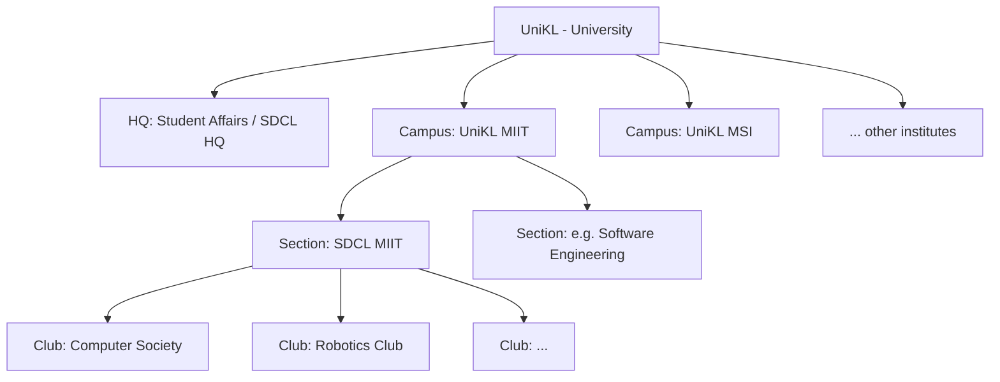

# UniPact Campus: Club System Plan (UniSkill port + SRS v2.2.1 plug-in)

Status: **draft for review**. Nothing here is built yet.
Branch: `claude/club-system-implementation-uxekcn`

---

## 1. What this is

UniKL has cleared UniPact to run a club system. The Dean wants a **pilot that shows results** before a wider rollout.

- **Core of the pilot: UniSkill** (Ashraf Rahimi's FYP, supervised by Ts. Dr. Noor Widasuria). It covers club membership, club activities, advisor oversight, SDCL administration and GHOCS co-curricular points. We rebuild it inside UniPact (Django + React) rather than run the Laravel app beside it.
- **Prepared to plug in: SRS v2.2.1** (club sponsorships from companies). It is already in the codebase but was postponed until a university approved it. Once UniSkill clubs exist and are verified by the university, the v2.2.1 sponsorship flow attaches to them.

### 1.1 Sources studied

| Source | Read | Notes |
|---|---|---|
| UniKLSKILL SRS v2.0 (PDF) | Sections 1–3 in full (FR_001–FR_028 and all use cases) | Drive's text export stops after FR_028. Sections 4–6 (interfaces, NFRs) and FR_029–FR_032 were **not** readable, but the feature table in §2.2 lists all 32 features. |
| UniKLSKILL FYP2 Report (PDF) | Chapters 1–3 and Chapter 4 up to Module 4 | The export stops partway through Chapter 4. **Not read:** Modules 5–8 detail, Chapter 5 (results), Chapter 6, and the ERD/UML appendices. |
| UniKLSKILL STP v2 (PDF) | Module lists per role, test approach, risk table, sample cases | |
| Research paper (PDF) | In full | UAT results (30 students) and future recommendations |
| Presentation slides (PDF) | In full | Includes the radar-chart problem slide |
| GHOC Mapping & point distribution (DOCX) | In full | DNA categories → SC1–SC5 skills, S.P.I.C.E.S elements |
| `uniklskill.zip` (Laravel source, 235 MB) | **Not read** | Too large for the Drive connector (10 MB limit), and Drive downloads are blocked from the build container. Its database migrations would confirm the exact data model. **Please share `database/migrations/` and `routes/web.php` on their own.** |
| UniPact SRS v2.2.1 (DOCX in repo) | In full | REQ-3.1.5, 3.1.12, 3.2.x, 3.4.x, 3.6.x |
| UniPact codebase | Club track: `users/models.py`, `campaigns/models.py`, club views and serializers, `impact/` check-in, architecture lock | |

---

## 2. What UniSkill does (condensed)

**Users:** Student, Student (High-Committee), Club Advisor (lecturer), Secretary (staff), SDCL Admin.

| # | Module | Features |
|---|---|---|
| 1 | Accounts | F001–F003: register (username, student ID, email, password), log in, log out |
| 2 | Club members | F004–F007: join request → High-Committee or Advisor approves or rejects; add and remove members; Advisor promotes and demotes High-Committee and sets each person's position |
| 3 | Club activities | F008–F014: High-Committee proposes → Advisor approves (the STP adds "before submission to SDCL") → published; Advisor can post directly; members-only discussion thread per activity; post-activity report → Advisor remarks |
| 4 | Club establishment | F015–F019: a student proposes a new club → SDCL approves → SDCL creates, edits or removes the club |
| 5 | Advisors | F020–F022: SDCL assigns and unassigns advisors; the advisor is notified |
| 6 | News | F023–F025: SDCL posts site news |
| 7 | Co-curricular points (GHOCS) | F026–F030: a student submits an achievement with a certificate → Secretary approves and allocates points → the student sees their total and prints a transcript |
| 8 | FAQ chatbot | F031–F032 |

**Problems it set out to solve:**
- **P1:** Club information is scattered across ECITIE, WhatsApp and Teams.
- **P2:** GHOCS claims get rejected because students pick the wrong category.
- **P3:** Secretaries miss old claims, so points arrive late or never.
- **P4 (from the GHOC mapping doc):** the radar chart is opaque. More GHOCS points does not mean a bigger radar, and students cannot see how to improve it.

**UniSkill's own future recommendations**, which UniPact already covers or can cover:
- Live email notifications: UniPact already has them (`notifications.py`).
- A real, scalable database: UniPact runs on Postgres.
- Integration with the official UniKL database: planned as Phase 4.
- A smarter chatbot: Phase 4.

---

## 3. Hierarchy: the core design decision

Both earlier options were rejected because UniKL has many levels. Neither "add three global roles" nor "per-club role only" can express someone who is, at the same time:

- an MIIT lecturer,
- advisor of Club A,
- co-advisor of Club B,
- and a GHOCS secretary for one section.

Nor can they express a student who is President of one club and an ordinary member of two others.

### 3.1 Principle: separate *who you are* from *what you can do, and where*

1. **Account type** (`User.Role`): what kind of person logs in. This stays small and global. It also preserves the architecture lock: `STUDENT`, `CLUB`, `COMPANY` and `ADMIN` all stay exactly as they are.
   - We add **one** account type, `STAFF`, for university lecturers and officers. They are not students, companies or UniPact admins, and they must not see the student marketplace.
2. **Organisation tree:** UniKL's structure stored as data, not code. A new campus or section is a new row, not a migration.
3. **Role assignments:** each one is *(person, role, scope node, term)*. Permissions come from the assignments, and a role granted on a node also covers everything below it.

### 3.2 Organisation tree (assumed — please correct)



`OrgUnit(id, parent, kind ∈ {UNIVERSITY, CAMPUS, SECTION, CLUB}, name, code, is_active)`.

A **Club** is an `OrgUnit` of kind `CLUB`, plus a `Club` detail record (description, logo, DNA category, status, socials). Because clubs are part of the tree, the same permission rule works at every level.

### 3.3 Roles and where they apply

| Role | Assigned at | Can do | Replaces in UniSkill |
|---|---|---|---|
| `PLATFORM_ADMIN` | (global, `User.Role.ADMIN`) | Everything; onboards universities | — |
| `UNI_ADMIN` | University | Manage campuses, appoint campus admins, set GHOCS point rules | — |
| `CAMPUS_ADMIN` (SDCL head or officer) | Campus | Approve or reject new clubs, create and edit clubs, assign advisors, post news, final approval on escalated activities, pilot dashboard | SDCL Admin |
| `DEAN_HEP` (Deputy Dean, Student Affairs) | Campus | Approve activities that need HEP sign-off (see §3.4); read-only reports | — (implied by the "signed by advisor and deputy dean" rule already in `CompanyProfile`) |
| `GHOCS_SECRETARY` | Campus or Section | Review GHOCS claims in their scope, allocate points | Secretary |
| `ADVISOR` / `CO_ADVISOR` | Club | Approve activities, promote and demote, set positions, remark on reports, approve sponsorship applications (v2.2.1) | Club Advisor |
| `COMMITTEE` with a **position** | Club | Manage join requests, propose activities, post announcements, file reports | Student (High-Committee) |
| `MEMBER` | Club | View activities, discuss, check in, claim GHOCS | Student |

**Committee positions** are data, not roles. Each university can edit its own list. The default list is: President, Vice President, Secretary, Treasurer, Exco/AJK, and Other (free text).

Position decides small things:
- Only the **President** can hand over presidency.
- Only the **President or Treasurer** can act on sponsorship money (v2.2.1).

**Term:** every assignment has `session` (e.g. "2026/2027 Sem 1"), `starts_on`, `ends_on` and `ended_reason`. Handover at the end of a session ends one term and starts the next, so history is kept for transcripts ("President, 2026/27").

**Permission check:**
```
can(user, action, target) =
    any assignment A of user where
        A.is_current
        and A.scope is target's node or one of its ancestors
        and action ∈ ROLE_ACTIONS[A.role]
```
This lives in one module (`campus/permissions.py`) with a DRF permission class, so every endpoint uses the same rule.

### 3.4 Approval chains are configurable, not hard-coded

UniSkill hard-codes "High-Committee proposes → Advisor approves", while the STP says "→ then SDCL". Real campuses differ, so each campus stores an `ApprovalPolicy` per item type:

```
ACTIVITY_PROPOSAL (MIIT):
  step 1: ADVISOR of the club                  (always)
  step 2: CAMPUS_ADMIN                         (if off-campus OR budget > RM 1,000 OR external sponsor)
  step 3: DEAN_HEP                             (if overnight OR overseas)
CLUB_ESTABLISHMENT: CAMPUS_ADMIN → DEAN_HEP
GHOCS_CLAIM:        GHOCS_SECRETARY of the student's campus/section
SPONSORSHIP_APPLY:  ADVISOR (v2.2.1 plug-in)
```

Each request keeps its own trail of `ApprovalStep(request, step_no, role, decided_by, decision, comment, decided_at)`. This trail is the evidence the Dean can audit.

---

## 4. Data model (new Django app: `campus`)

New tables only. Nothing in `users` or `campaigns` is dropped or altered destructively (per the migration guardrails).

| Model | Key fields |
|---|---|
| `OrgUnit` | parent, kind, name, code, is_active |
| `StaffProfile` | user (STAFF), full_name, staff_id, title, home_unit → OrgUnit |
| `RoleAssignment` | user, role, scope → OrgUnit, position (nullable), session, starts_on, ends_on, ended_reason, assigned_by |
| `Club` | unit (1:1 OrgUnit), slug, description, logo, cover, dna_category, status {PROPOSED, ACTIVE, SUSPENDED, DISSOLVED}, socials, `sponsorship_profile` → `users.ClubProfile` (nullable; the v2.2.1 plug-in) |
| `ClubEstablishmentProposal` | proposer (student), proposed name, objectives, proposed advisor, founding members (≥ N), constitution file, status, approval trail |
| `JoinRequest` | club, student, message, status, decided_by, decided_at |
| `Activity` | club, title, description, dna_category (predetermined, per the GHOC doc), venue, on/off-campus, starts/ends, budget, expected participants, status {DRAFT, PENDING, APPROVED, REJECTED, PUBLISHED, COMPLETED, CANCELLED}, check-in code, ghocs_level (campus / state / national / international) |
| `ActivityComment` | activity, author, body, is_hidden (moderated by Committee or Advisor) |
| `Attendance` | activity, student, role at activity {PARTICIPANT, COMMITTEE, ORGANISER}, checked_in_at, method {QR, MANUAL} |
| `ActivityReport` | activity, author, summary, photos/files, attendance count; `ReportRemark` (advisor) |
| `Announcement` | club, author, body, pinned |
| `News` | scope → OrgUnit (campus or university), title, body, cover, published_at |
| `ApprovalPolicy` / `ApprovalRequest` / `ApprovalStep` | generic; target via content type |
| `GhocsPointRule` | university, achievement type, level, role → points (**needs UniKL's official table**) |
| `GhocsClaim` | student, source {CLUB_ACTIVITY (linked Attendance), EXTERNAL (My Excellence)}, title, dna_category, spices_element, level, role, certificate, status, points_awarded, reviewed_by, reviewed_at, reject_reason |
| `Notification` | in-app feed (email already handled by `notifications.py`) |

**Reuse from UniPact as it stands:**
- University-email verification (`@s.unikl.edu.my` proves studenthood).
- The `impact` QR check-in pattern for `Attendance`.
- `SystemLog` for the audit trail.
- The transactional email layer.
- `StudentProfile.year_of_study` and `current_semester`.
- `StudentProfile.club_affiliation_name/role` become a **computed fallback** from current `RoleAssignment`s. The string fields are kept as they are, per the architecture lock.

### 4.1 GHOCS: make the radar transparent (fixes P4)

From the GHOC mapping doc:
- **The activity decides the DNA category.** The student does not choose it, which removes the main cause of rejection (P2).
- Each DNA category maps to skills:

| DNA category | Transferable skills |
|---|---|
| Active Programme | SC1, SC2, SC3 |
| Sports & Recreation | SC1, SC2, SC3 |
| Entrepreneur | SC4, SC5 |
| Global | SC2, SC3 |
| Graduate | SC2, SC3, SC4 |
| Leadership | SC1, SC2, SC5 |

- Approved points are spread evenly across the mapped SCs, and the student sees the calculation line by line. A "how to grow your web" hint names the weakest SC and the DNA categories that feed it. The ECITIE calculation is hidden; ours is shown. **The exact weighting must be confirmed by UniKL before points are called official.** In the pilot they are labelled "pilot estimate".
- The Secretary's queue is sorted **oldest first**. Each claim shows its age, and there are reminder emails at 3 and 7 days (fixes P3). The pilot measures median time to decision.
- A claim from a club activity is pre-filled from the Attendance record (activity, DNA category, level, role), so the student only confirms it.

---

## 5. How SRS v2.2.1 plugs in (prepared, switched off in the pilot)

Today a v2.2.1 club is a **single login** (`role: CLUB` + `ClubProfile`) with an invited roster (`ShadowUser`). The SRS paused it for lack of university clearance and a verified club identity. UniSkill provides both. The plug-in:

1. **Verification:** a `Club` that the campus has made ACTIVE counts as university-verified. When a club turns sponsorship on, the system creates or links its `ClubProfile` (`Club.sponsorship_profile`) and copies `verification_status = VERIFIED` (REQ-3.1.5 is then met by SDCL itself rather than by a document upload).
2. **Who acts for the club:** the `CLUB` login is kept as-is for clubs outside UniKL. For UniKL clubs, the current President and Treasurer act through their own student accounts. The system resolves "acting as Club X" from their `RoleAssignment`.
3. **Roster:** REQ-3.6.1 and REQ-3.6.2 read from club `RoleAssignment`s instead of `ShadowUser`. `ShadowUser` stays for non-UniKL clubs and is still tested.
4. **Applying to a sponsorship quest** (`/api/campaigns/<id>/apply/`) adds a `SPONSORSHIP_APPLY` approval request to the club's Advisor before the company sees it.
5. **Money:** the club bank account (a university-sanctioned account, per REQ-3.2.x) is entered by the Treasurer and confirmed by the Campus Admin.
6. **Sponsored activity:** an awarded campaign creates an `Activity` with `external sponsor = true`. That runs the stricter approval chain, and attendees can claim GHOCS for it.
7. **Feature flag:** `CAMPUS_SPONSORSHIP_ENABLED` is off for the pilot. Endpoints exist, are tested, and return 404 while the flag is off.

---

## 6. Phases

| Phase | Scope | Shown to Dean |
|---|---|---|
| **0. Foundations** | `campus` app, OrgUnit tree, STAFF accounts (invite-only; staff never self-register), RoleAssignment + permission module, ApprovalPolicy engine, seed command for UniKL → MIIT → SDCL, Django admin | — |
| **1. Clubs (pilot drop 1)** | Club directory and profile (F019), join requests (F004–F006), committee and positions, promote and demote (F007), advisor assignment and notification (F020–F022), club establishment proposals (F015–F018), activities: propose → approve → publish (F008–F012), QR attendance, discussion and moderation (F013–F014), activity reports and remarks, announcements, campus news (F023–F025), in-app and email notifications | Yes |
| **2. GHOCS (pilot drop 2)** | Claims from activities and external achievements, Secretary queue (oldest-first, reminders), point rules, transparent SC1–SC5 radar with improvement hints, printable transcript (F026–F030) | Yes |
| **3. Pilot dashboard and evaluation** | Campus dashboard (counts, turnaround times, participation by DNA category), CSV export, built-in UAT survey reusing UniSkill's 15-question Likert form so results compare with the FYP's 30-student baseline | Yes, this is the "show result" |
| **4. Later** | v2.2.1 switch-on (§5), FAQ assistant (F031–F032) on the Claude API grounded in campus FAQ and news, UniKL SSO / official GHOCS sync, other campuses | — |

Every phase must pass `python manage.py test` and `npm run build` with 0 errors, follow `STYLE_GUIDE.md` (Navy/Cyan, Outfit/Inter), and add **no** changes to existing CLUB/STUDENT endpoints beyond the computed club affiliation.

### 6.1 Pilot proposal (for the Dean)

- **Where:** UniKL MIIT, one SDCL unit, **3–5 clubs** with willing advisors, one semester (~14 weeks).
- **Who:** about 150–300 students, the clubs' advisors, 1–2 GHOCS secretaries, and 1 SDCL officer.
- **Measures**, with a baseline taken from current ECITIE practice in weeks 1–2:

| Measure | Fixes | Target |
|---|---|---|
| Median days from GHOCS claim to decision | P3 | Lower than baseline |
| Share of claims rejected for wrong category | P2 | Near zero, because the category is pre-filled |
| Join-request turnaround (hours) | P1 | — |
| Activities proposed, approved and held; attendance per activity | P1 | — |
| Students with a balanced web (all 5 SCs > 0) | P4 | — |
| UAT Likert scores (functionality, usability, satisfaction) | — | Compared with the FYP baseline: 61% / 61% / 62% "strongly agree" |

- **Data and PDPA:** consent at sign-up (already in place), data kept in Malaysia-region storage if UniKL requires it, and points labelled "pilot, not official" unless UniKL confirms the point table.

---

## 7. Decisions needed from you or UniKL

1. **Hierarchy:** is the tree in §3.2 right? Which levels exist between the university and a club (campus → section? faculty?), and who sits at each?
2. **Account type `STAFF`:** OK to add it as a fifth `User.Role` (all four existing roles unchanged)?
3. **Approval rules:** which activities need SDCL or HEP sign-off (budget threshold, off-campus, overnight, external sponsor)?
4. **GHOCS point table:** the official points per achievement level and role, and how UniKL weights DNA categories → SC1–SC5. Until then, pilot points are estimates.
5. **Secretary scope:** one per campus, or per section?
6. **Pilot clubs and advisors:** names, and the SDCL contact who will hold Campus Admin.
7. **Laravel source:** please share `database/migrations/` and `routes/web.php` from `uniklskill.zip` so the data model can be checked against Ashraf's tables.
8. **Branding:** under UniPact ("UniPact Campus") or as "UniKLSKILL powered by UniPact"?

Once §7.1, 7.2 and 7.3 are answered, Phase 0 can start. Points 7.4 and 7.5 are only needed before Phase 2.
